# Project screenshot gallery

Project screenshots. Original files in Downloads were preserved; repository copies have descriptive filenames.

Earlier screenshots show historical setup: built-in source control was later replaced by GitHub Actions, and package imports were still in progress when captured. Broad Contributor roles reflect the lab setup, not a least-privilege recommendation. The federated-credential screenshot predates the subject correction; the later login screenshot shows successful authentication.

Solid redactions cover the subscription ID, group object IDs, user principal names, personal account names, and selected local/GitHub identifiers. Lab resource names and synthetic user names remain visible. Original images are backed up outside the repository; public copies have permanently replaced pixels, not removable overlays. Secret-name screenshots do not show secret values.

## Azure foundation

### Initial powershell runtime

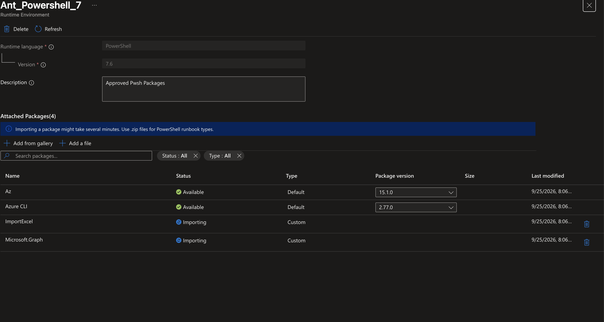

### Automation resource group

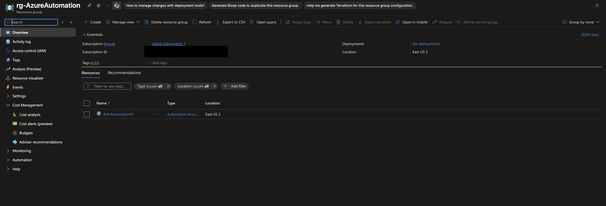

### Automation contributor role

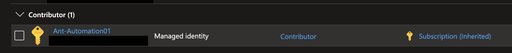

### Automation storage roles

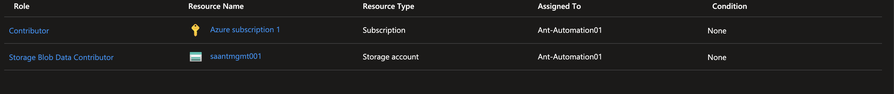

### Inventory csv output

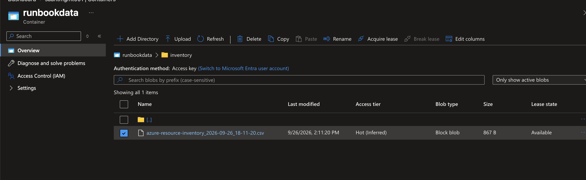

## GitHub deployment and Graph setup

### Github deployment app

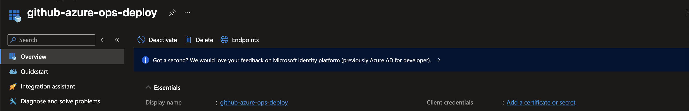

### Original source control

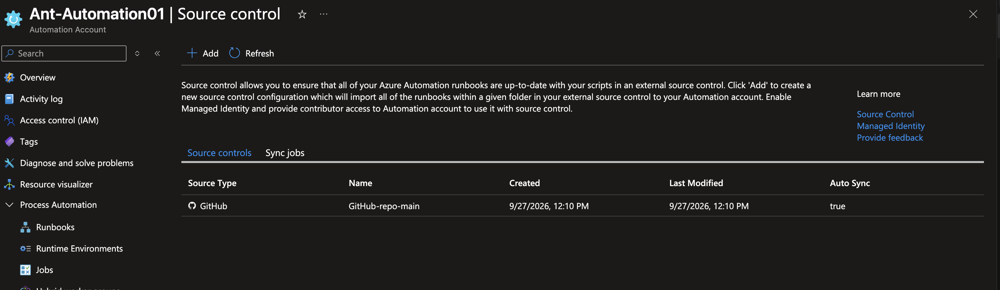

### Github federated credential

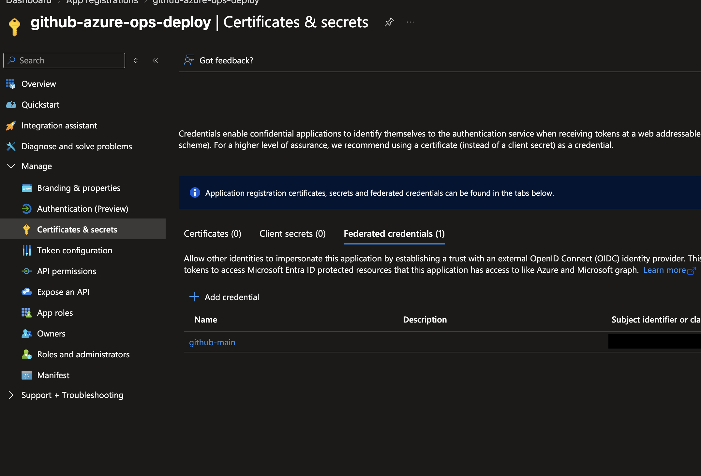

### Deployment automation contributor

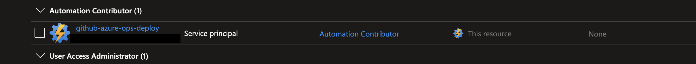

### Github actions secret names

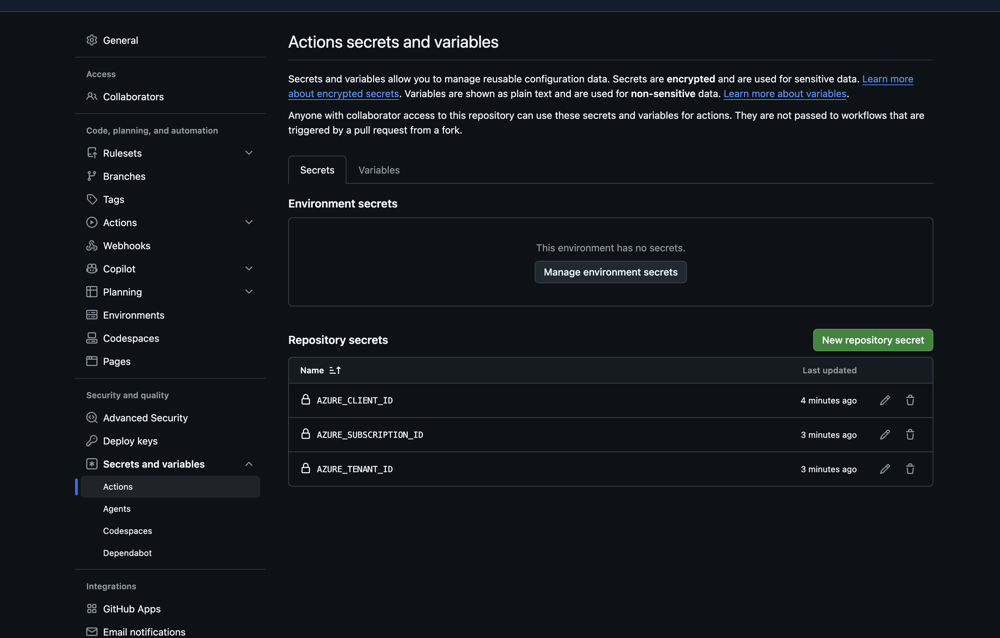

### Github azure login success

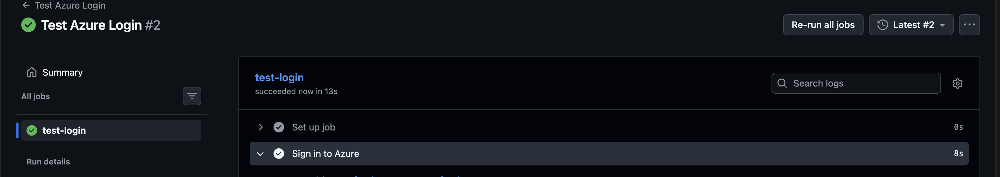

### Graph permissions assigned

### Graph command not found

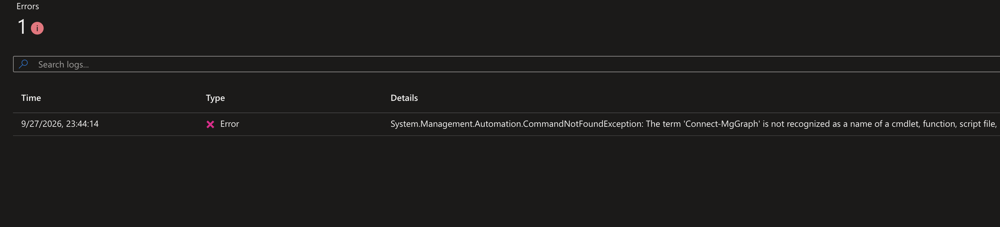

## Runtime and cleanup

### Graph runtime packages

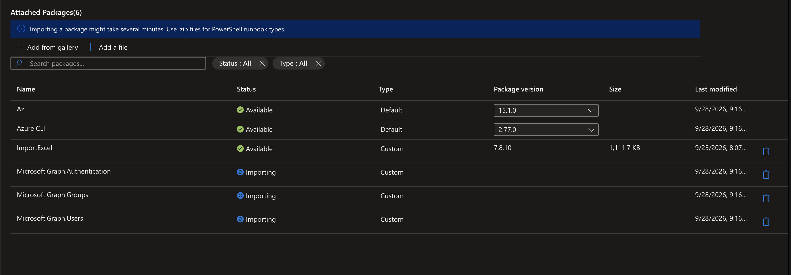

### Remaining user

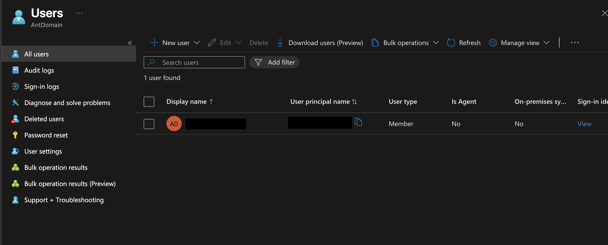

### Groups cleared

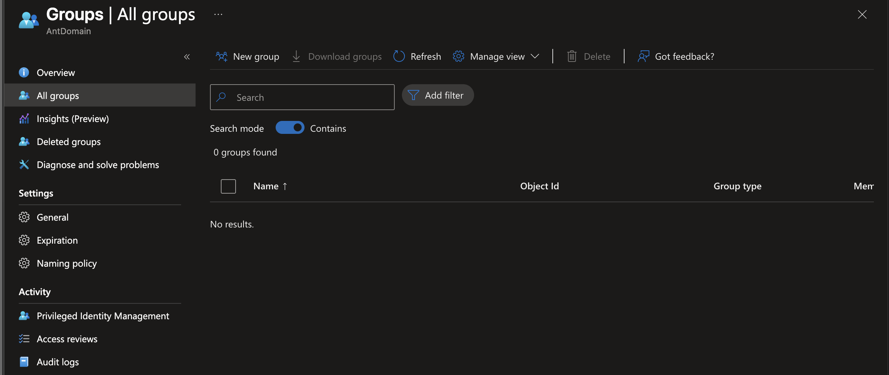

## CSV user creation

### Key vault secret list

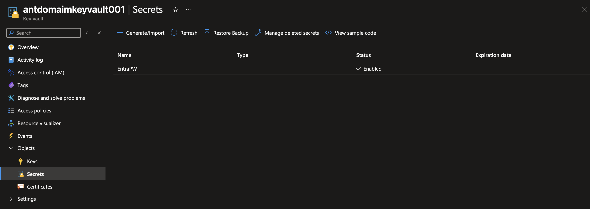

### Csv upload powershell

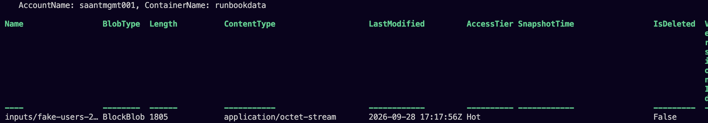

### Operator storage role

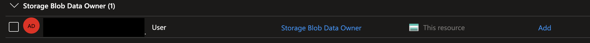

### Csv blob input

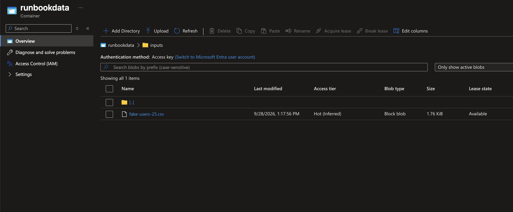

### Key vault secrets user

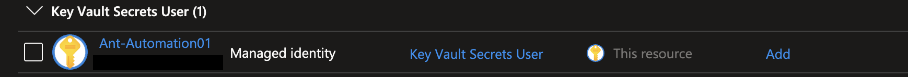

### User creation completed

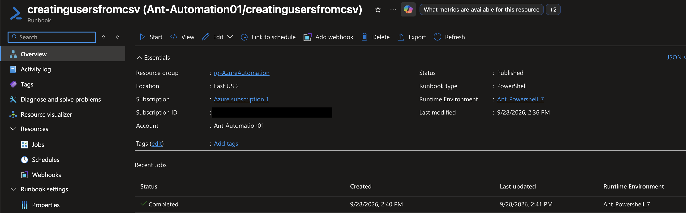

### Created users

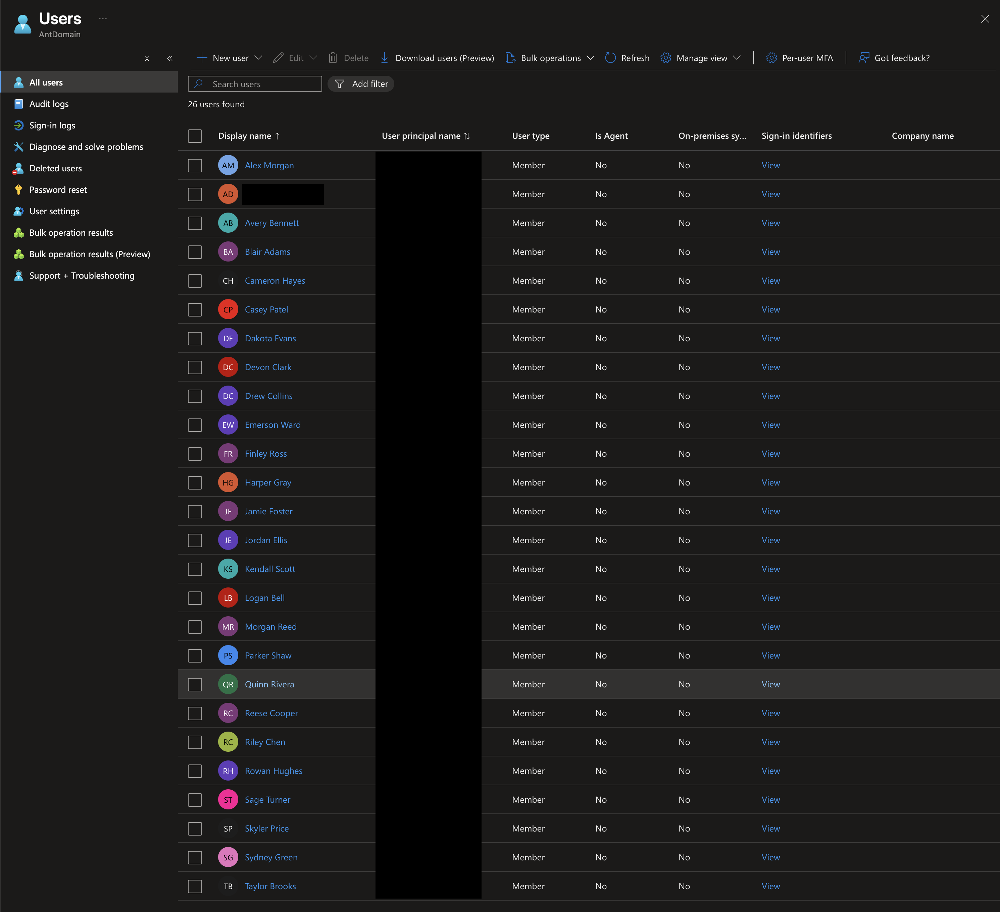

## Department groups and membership

Six assigned security groups created from departments:

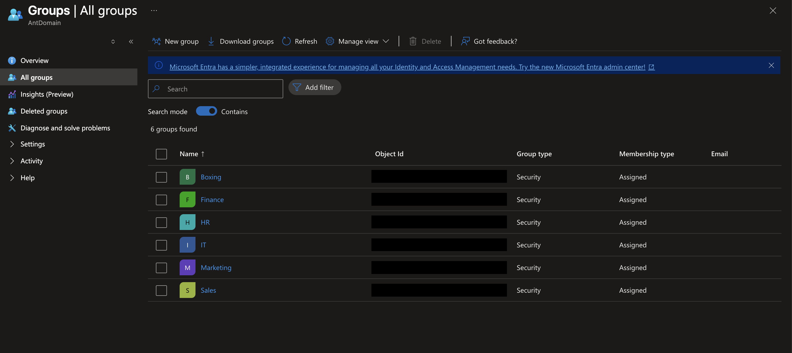

Add-User-To-Groups completed on Azure with zero errors and warnings:

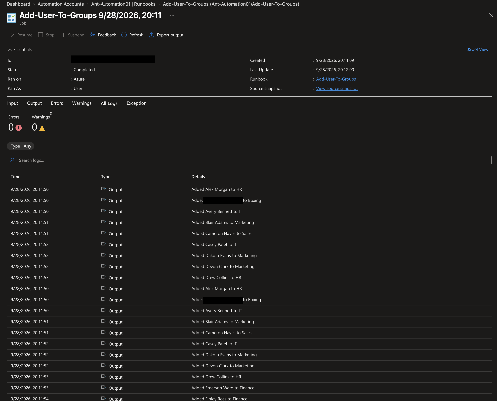

Direct user member counts: HR 5, Sales 6, IT 5, Finance 5, Marketing 4, Boxing 1. These total 26 memberships.

